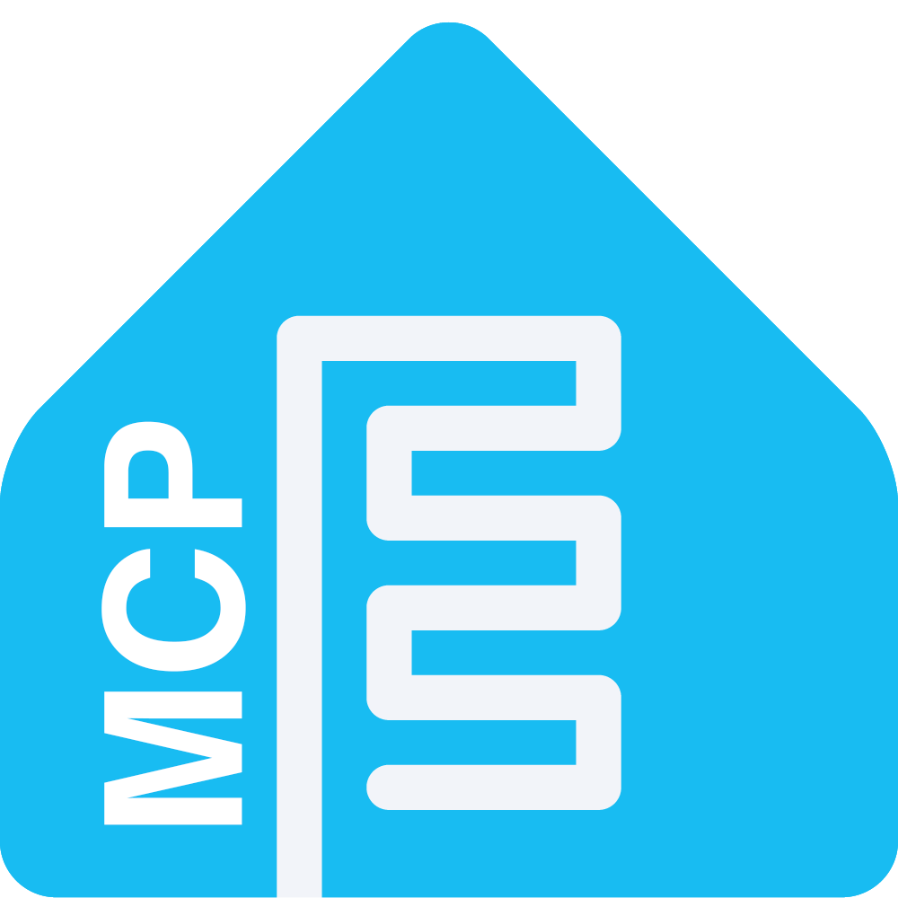

<h1>
  ESPHome MCP Server
  
</h1>

A custom [Model Context Protocol (MCP)](https://modelcontextprotocol.io/) server for managing ESPHome devices via the ESPHome Device Builder WebSocket & REST API.

It allows AI assistants (like Claude, Gemini, or custom agents) to inspect, edit, validate, compile, and flash ESPHome firmware Over-The-Air (OTA) directly from conversation context.

---

## Features

- **`esphome_list_devices`**: Lists all registered ESPHome devices, IP addresses, online statuses, board architectures, and YAML filenames.
- **`esphome_get_config`**: Retrieves full YAML configuration for any device (e.g. `esp32-shelf.yaml`).
- **`esphome_update_config`**: Saves updated YAML configurations directly to the ESPHome instance.
- **`esphome_validate`**: Validates YAML syntax & component configurations before compilation.
- **`esphome_compile`**: Triggers C++ compilation of device firmware.
- **`esphome_flash_ota`**: Flashes compiled firmware Over-The-Air (OTA) over Wi-Fi.

---

## How It Works

The server connects directly over local WebSockets to the standard ESPHome Device Builder dashboard (port `6052`) running on your network. 

- **No Home Assistant Add-ons Required**: It bypasses third-party container layers and talks directly to ESPHome.
- **No SSH / Samba Mounts Needed**: Configs are read, updated, validated, and flashed over the native ESPHome WebSocket API.

---

## Quick Start (Automated Setup)

Run the automated installer script to create the virtual environment, install dependencies, verify your ESPHome connection, and automatically register the server with your MCP client:

```bash
git clone https://github.com/saihgupr/esphome-mcp.git
cd esphome-mcp
python3 install.py
```

The script will prompt for your ESPHome IP/Host & Port, test the connection, create the `.venv`, and automatically add `esphome` to your `mcp_config.json` (Antigravity IDE, Claude Desktop, Cursor, etc.).

> **Note**: After running `install.py`, **fully restart your IDE or AI Client application** (Quit & Relaunch) to load the new MCP server.

---

## Manual Configuration (Alternative)

If you prefer to configure manually, create `.venv` and update your MCP client configuration file (e.g. `~/.gemini/config/mcp_config.json` or `claude_desktop_config.json`) using **absolute paths**:

```json
{
  "mcpServers": {
    "esphome": {
      "command": "/Users/your-username/path/to/esphome-mcp/.venv/bin/python",
      "args": [
        "/Users/your-username/path/to/esphome-mcp/server.py"
      ],
      "env": {
        "ESPHOME_HOST": "192.168.1.4",
        "ESPHOME_PORT": "6052"
      },
      "disabled": false
    }
  }
}
```

---

## Local AI Models & Self-Hosted Clients

Because ESPHome MCP Server runs as a standard `stdio` MCP process, it works with open-source local LLMs (e.g., Qwen2.5-Coder, Llama 3) via MCP-compatible clients:

### Compatible Local Clients & Setup

1. **Continue (VS Code / JetBrains)**:
   Add the server to your `.continue/config.json` under `experimental.mcpServers`:
   ```json
   {
     "name": "esphome",
     "command": "/path/to/esphome-mcp/.venv/bin/python",
     "args": ["/path/to/esphome-mcp/server.py"],
     "env": {
       "ESPHOME_HOST": "192.168.1.4",
       "ESPHOME_PORT": "6052"
     }
   }
   ```

2. **Open WebUI / Ollama / LM Studio**:
   Connect `esphome-mcp` using any MCP stdio bridge tool or client extension (such as Open WebUI MCP Actions or MCPO). Point your client at your local model server (e.g. Ollama `qwen2.5-coder` or `llama3.3`).

3. **Cursor / LibreChat**:
   Add `esphome-mcp` as a stdio server in settings and connect your preferred local provider endpoint (Ollama `/v1`, LM Studio `/v1`, or vLLM).

> **Tip for Local Models**: Tool calling requires reliable function call formatting. We recommend function-calling capable local models such as **Qwen2.5-Coder** (14B/32B) or **Llama 3.1/3.3** for optimal YAML editing and tool execution.


## Environment Variables

| Environment Variable | Default Value | Description |
| :--- | :--- | :--- |
| `ESPHOME_HOST` | `192.168.1.4` | IP address or hostname of your ESPHome Device Builder / Home Assistant instance. |
| `ESPHOME_PORT` | `6052` | Port for the ESPHome web dashboard / WebSocket API. |

---

## Usage & Examples

Once configured in your MCP client, you can manage your ESPHome devices using natural conversation.

### Example Prompts:

- **Check Device Status**:
  > *"List all my ESPHome devices and show which ones are currently online."*

- **Inspect Configuration**:
  > *"Show me the configuration file for `esp32-shelf.yaml`."*

- **Edit, Validate & OTA Update**:
  > *"Update `esp32-shelf.yaml` so pressing the door button triggers a 180-degree LED hue shift for half a second. Validate the config, and if valid, flash the update OTA over Wi-Fi."*

- **Compile Test**:
  > *"Check `nodemcu-2.yaml` for syntax errors and compile the binary to verify the build."*

---

## Contributing

Contributions are welcome! Please submit all Pull Requests to the **develop** branch.

1. Fork the repository
2. Create a feature branch (`git checkout -b feature/awesome-feature`)
3. Commit your changes and push to your fork
4. Open a Pull Request to **develop**

---

## Support & Feedback

If you encounter any issues, bugs, or have feature requests, please [open an issue on GitHub](https://github.com/saihgupr/esphome-mcp/issues).

ESPHome MCP Server is open-source and free. If you find it useful, consider giving it a star ⭐ or making a donation to support development!

[](https://ko-fi.com/saihgupr)
